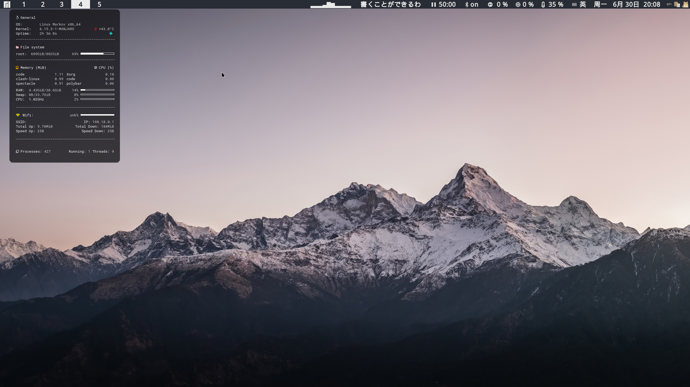
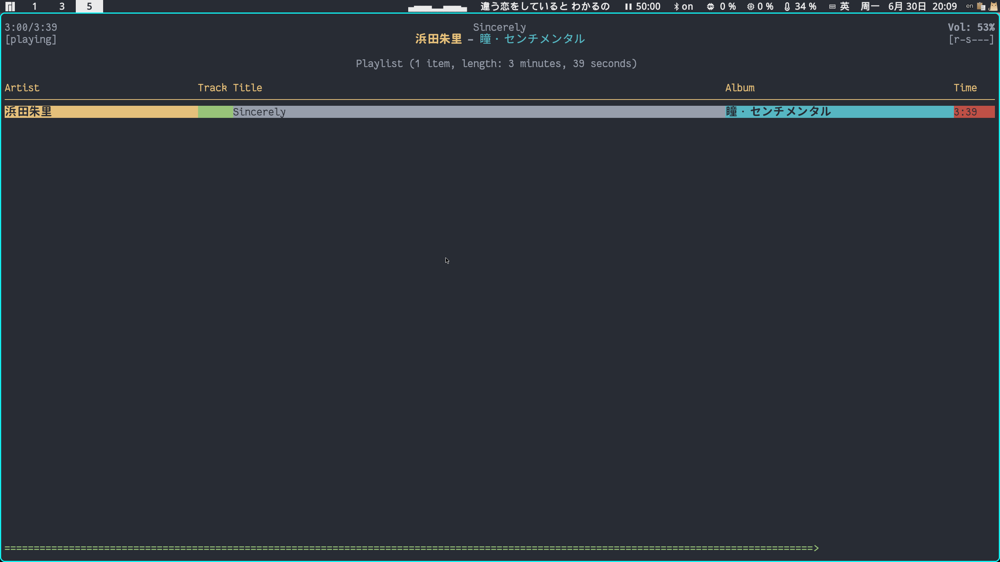
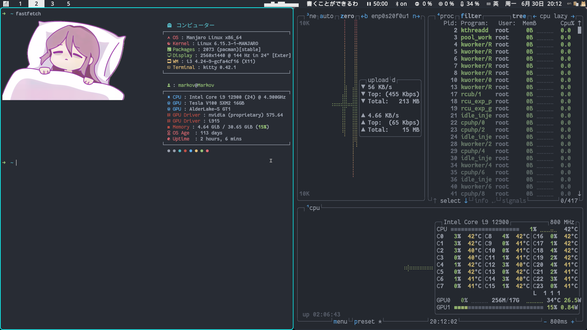
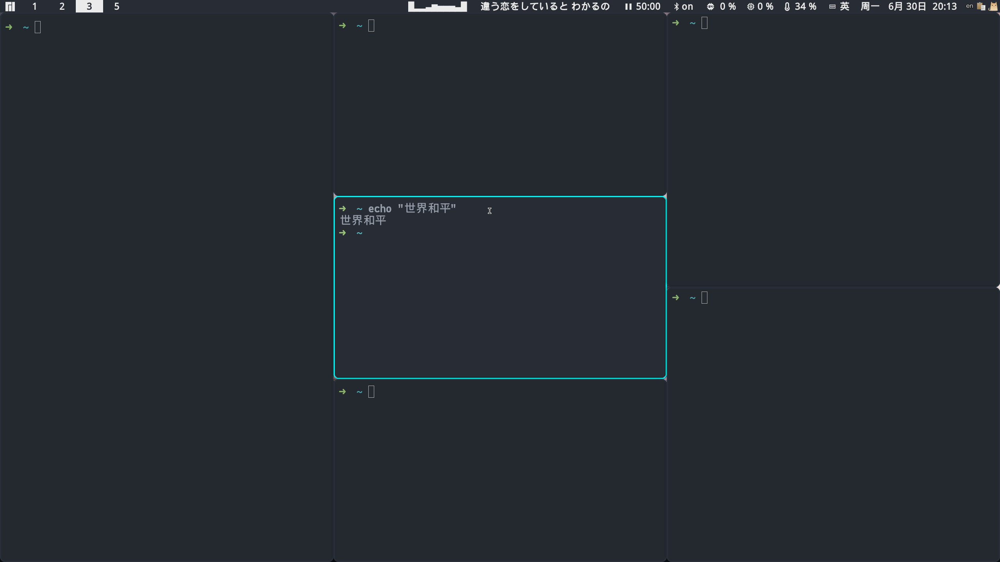
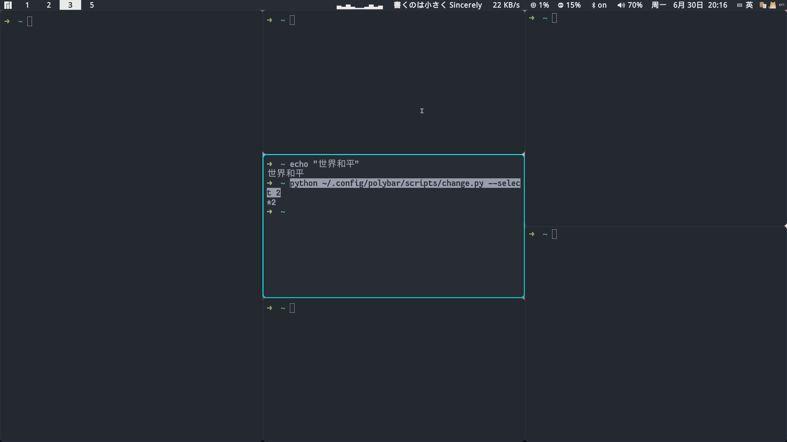
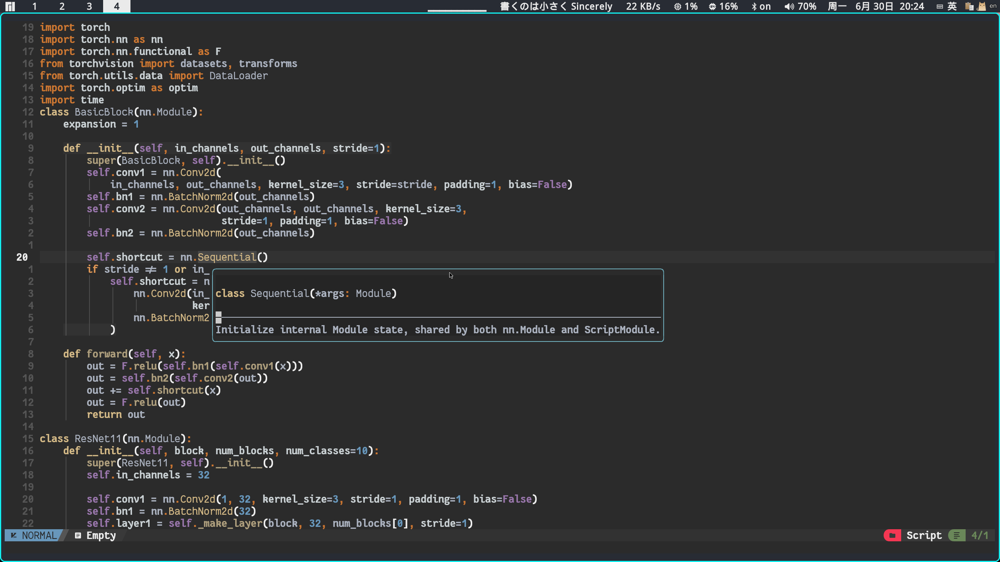

<div align="center">

# fantastic-i3

i3-style tiling desktops for Linux and macOS

[Linux: i3-wm](#linux-i3-wm) · [macOS: yabai](#macos-yabai) · [中文](README.zh-CN.md)

</div>

## Linux: i3-wm

i3 on X11 with polybar, rofi, kitty, picom, dunst, conky and NvChad, all in one MacTahoe dark theme. Collected from GitHub and tweaked. X11 isn't fashionable, but it's simple and stable.

<table>
  <tr>
    <td width="33%"></td>
    <td width="33%"></td>
    <td width="33%"></td>
  </tr>
  <tr>
    <td align="center">Desktop</td>
    <td align="center">ncmpcpp</td>
    <td align="center">btop · fastfetch</td>
  </tr>
  <tr>
    <td></td>
    <td></td>
    <td></td>
  </tr>
  <tr>
    <td align="center">kitty</td>
    <td align="center">polybar styles</td>
    <td align="center">NvChad</td>
  </tr>
</table>

- **Theme**: GTK 2/3/4, Qt 5/6, fcitx5 and rofi in MacTahoe dark. `install.sh` installs the packages (Arch, yay). The file map, reload steps and pitfalls are in [THEME.md](THEME.md).
- **Polybar**: several styles. `python ~/.config/polybar/scripts/change.py --select 2` switches to #2, which has a CPU monitor.
- **Neovim**: [NvChad](https://nvchad.com/) with my mappings in `nvim/lua/mappings.lua`. Pair it with qutebrowser to spare your mouse and neck. Code hover is on `F`: press ⇧F twice to look up. OneDark matches the rest of the theme; I use Dracula.
- **Also**: conky from [slate-conky-theme](https://github.com/CrispyKSP/slate-conky-theme). For the login screen, [slick-greeter](https://github.com/linuxmint/slick-greeter) is worth a look.

## macOS: yabai

The same habits on macOS: yabai tiles windows, skhd handles the keys and SketchyBar replaces the menu bar. There are 17 workspaces, a window switcher with pinyin search, and per-app layout and workspace memory. It lives in its own repo, [fantastic-i3-macOS](https://github.com/mejistus/fantastic-i3-macOS), included here as the `macos` submodule.

On Apple Silicon, one line installs everything, Homebrew included, and clones fantastic-i3-macOS to `~/Documents/fantastic-i3-macOS`:

```sh
/bin/bash -c "$(curl -fsSL https://raw.githubusercontent.com/mejistus/fantastic-i3-macOS/main/install.sh)"
```

It's safe to rerun. At the end it lists what's left to do by hand and prints a key cheat sheet worth a screenshot. With this repo cloned, `git submodule update --init macos` fetches it, then run `bash macos/install.sh`.

| Key | Action |
|---|---|
| <kbd>⌥1</kbd> … <kbd>⌥0</kbd> | Go to workspace 1 … 10 |
| <kbd>⌥Z</kbd> <kbd>⌥X</kbd> <kbd>⌥C</kbd> <kbd>⌥B</kbd> <kbd>⌥N</kbd> <kbd>⌥M</kbd> <kbd>⌥T</kbd> | Go to workspace Z … T |
| <kbd>⌥⇧</kbd> + workspace key | Move the window there and follow it |
| <kbd>⌃H</kbd> / <kbd>⌃L</kbd> | Previous / next workspace |
| <kbd>⌥H</kbd> <kbd>⌥J</kbd> <kbd>⌥K</kbd> <kbd>⌥L</kbd> | Focus left, down, up, right (or ⌥ + arrows) |
| <kbd>⌥⇧H</kbd> <kbd>⌥⇧J</kbd> <kbd>⌥⇧K</kbd> <kbd>⌥⇧L</kbd> | Swap with the window there (or ⌥⇧ + arrows) |
| <kbd>⌥F</kbd> / <kbd>⌥⇧F</kbd> | Fullscreen / tile ↔ float |
| <kbd>⌥-</kbd> / <kbd>⌥=</kbd> | Shrink / grow (<kbd>⌥R</kbd>: resize mode) |
| <kbd>⌘⇥</kbd> | Window list. Type to search, pinyin too |
| <kbd>⌥⇥</kbd> / <kbd>⌘Space</kbd> | App list with every Launchpad app (tap ⌥⇥: previous app) |
| <kbd>⌃S</kbd> <kbd>M</kbd> / <kbd>⌃S</kbd> <kbd>W</kbd> | Remember the app's layout / workspace |
| <kbd>⌃S</kbd> <kbd>Esc</kbd> | Reload the config |
| <kbd>⌥⇧↩</kbd> | Switch between the top bar and the macOS menu bar |
| <kbd>⌥D</kbd> / <kbd>⌥⇧D</kbd> | Finder here / Documents in a new Finder window |
| <kbd>⌥G</kbd> | Browser on workspace 1 |

All the keys, fixed workspaces, the top bar, instant switching and troubleshooting: **[fantastic-i3-macOS](https://github.com/mejistus/fantastic-i3-macOS)**.

## Credits

Built on [NvChad](https://nvchad.com/), [slate-conky-theme](https://github.com/CrispyKSP/slate-conky-theme), [MacTahoe](https://github.com/vinceliuice/MacTahoe-gtk-theme), [yabai](https://github.com/asmvik/yabai), [skhd](https://github.com/asmvik/skhd), [SketchyBar](https://github.com/FelixKratz/SketchyBar) and many more. Respect for all these great open-source projects.

The Neovim config was mostly written by Claude Code. The Linux theme was fixed up with Muse Spark 1.3 Free and DeepSeek 4.1 Flash. Thanks to free software and free models.
